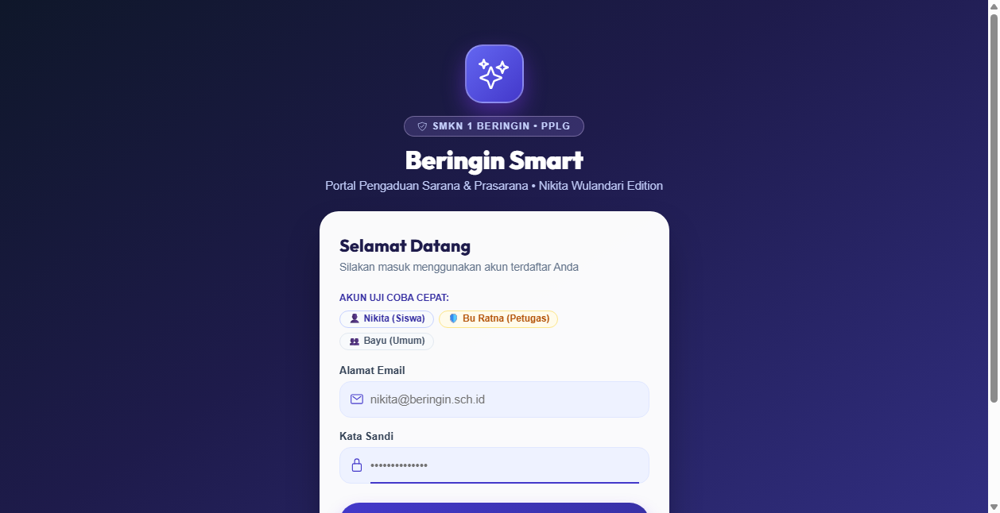
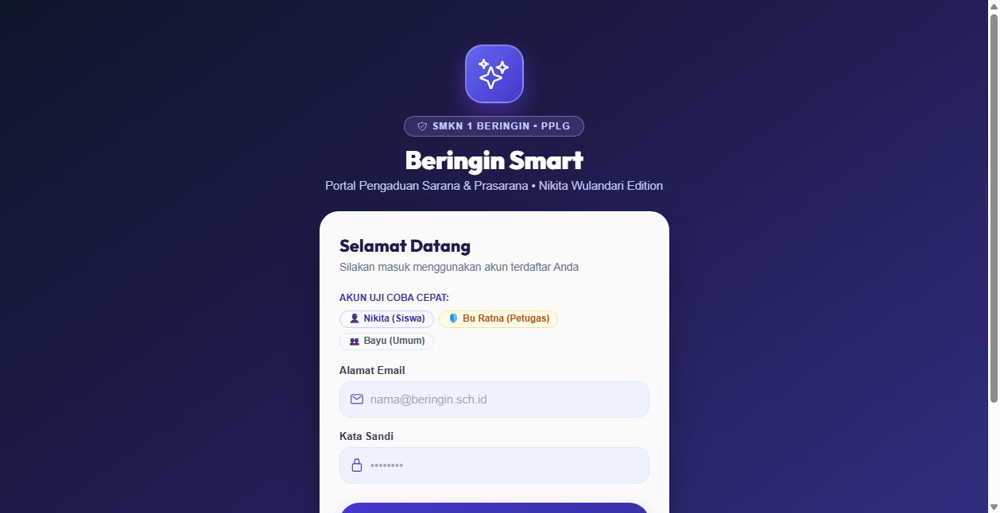
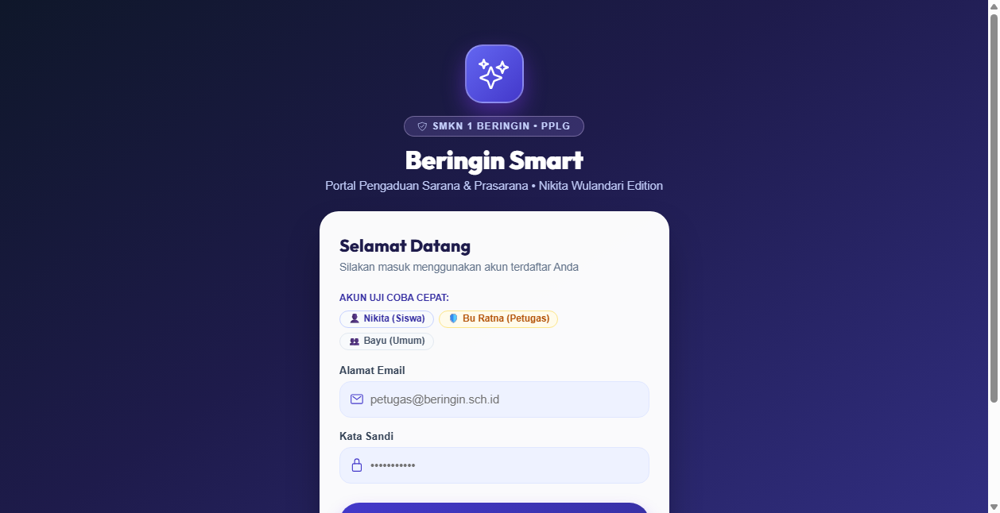
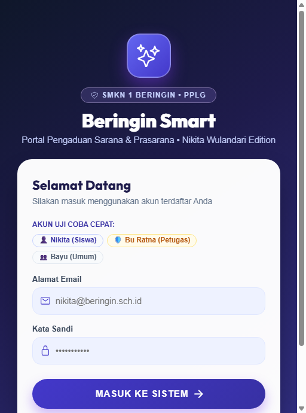

# Beringin Smart — Portal Pengaduan Sarana & Prasarana Sekolah
> **Edisi Khusus: Nikita Wulandari (XI PPLG 2)**  
> **SMK Negeri 1 Beringin • Tahun Ajaran 2026/2027**  
> Standar Kompetensi Kerja Nasional Indonesia (SKKNI) No. 282 Tahun 2016  
> Tema Identitas Antarmuka: **Deep Indigo & Cyber Cobalt**

---

## 📌 Deskripsi Proyek
**Beringin Smart (Nikita Wulandari Edition)** adalah sistem informasi berbasis web dan mobile untuk memfasilitasi pelaporan kendala sarana prasarana sekolah di lingkungan SMK Negeri 1 Beringin. Aplikasi ini memungkinkan siswa melaporkan kerusakan secara cepat dengan validasi data terstruktur, sekaligus memudahkan staf sarpras dalam mengelola dan memantau status penyelesaian tiket secara *real-time*.

Dibangun menggunakan standar arsitektur industri:
- **Backend**: Laravel 11 RESTful API + Autentikasi Laravel Sanctum
- **Frontend**: React 18 + Ionic Framework v8 + TypeScript + Vite Bundler
- **Database**: MySQL 8.4 (Port 3306)
- **Tema Visual**: Nuansa modern **Deep Indigo (`#4338ca`)**, **Cyber Cobalt (`#6366f1`)**, dan **Midnight Canvas (`#eef2ff`)**

---

## 👥 Hak Akses & Akun Uji Coba (Demo Users)

| Peran (Role) | Nama Pengguna | Alamat Email | Kata Sandi | Cakupan Wewenang |
|---|---|---|---|---|
| **Siswa Utama** | Nikita Wulandari | `nikita@beringin.sch.id` | `password123` | Mengajukan laporan baru, melihat lini masa laporan sarpras, memfilter kategori, serta melihat detail status penanganan. |
| **Petugas Sarpras** | Bu Ratna | `petugas@beringin.sch.id` | `password123` | Mengelola antrean tiket perbaikan dan memperbarui status pengerjaan (*Diproses* / *Selesai*). |
| **Siswa Pendukung** | Bayu Pratama | `siswa@beringin.sch.id` | `password123` | Siswa kelas XI PPLG 1 untuk uji interaksi multi-pengguna. |

---

## 📸 Dokumentasi & Bukti Pengujian Antarmuka (11 Screenshot)

Alur verifikasi disusun sistematis berdasarkan tahapan siklus hidup penanganan tiket sarpras:

### 1. Antarmuka Portal Masuk Pengguna (Login)
Tampilan gerbang masuk sistem dengan tema Deep Indigo & Cyber Cobalt, dilengkapi tombol *quick-demo* untuk kemudahan pengujian autentikasi.


---

### 2. Pengujian Validasi Keamanan & Kredensial Salah
Uji ketahanan sistem terhadap upaya login menggunakan kata sandi yang salah. Sistem menolak akses dan menyajikan notifikasi peringatan.


---

### 3. Antarmuka Pelapor Siswa (Dashboard Nikita Wulandari)
Beranda utama siswa yang memuat sambutan personal untuk Nikita Wulandari dan lini masa seluruh tiket sarpras aktif.


---

### 4. Rincian Tiket Kerusakan (Tampilan Siswa / Read-Only)
Halaman rincian tiket pengaduan yang menyajikan data spesifik: kategori, pelapor, lokasi kerusakan, waktu lapor, dan status pengerjaan.


---

### 5. Penyaringan Laporan Berdasarkan Kategori Sarpras
Fitur filter interaktif berbasis chip kategori (Kelistrikan, Ruang Belajar, Fasilitas Umum, Keamanan) untuk mempermudah pencarian tiket.


---

### 6. Formulir Perekaman Tiket Sarpras Baru
Formulir pengajuan kerusakan fasilitas sekolah yang dilengkapi validasi field lokasi, kategori, judul, dan deskripsi komprehensif.


---

### 7. Sukses Perekaman Tiket Sarpras Baru
Bukti konfirmasi keberhasilan input tiket kerusakan baru ke server database dan langsung terintegrasi di feed aplikasi.


---

### 8. Dashboard Manajemen Petugas Sarpras (Bu Ratna)
Tampilan dashboard operasional bagi staf sarpras untuk memonitor seluruh pengaduan yang membutuhkan tindakan perbaikan.


---

### 9. Panel Aksi Tindak Lanjut Petugas
Panel eksekusi di halaman detail bagi petugas untuk melakukan eskalasi status (*Set Diproses* atau *Set Selesai*).


---

### 10. Konfirmasi Resolusi Status Selesai
Verifikasi pembaruan status tiket menjadi **SELESAI** dengan indikator visual hijau tanda perbaikan sarpras telah tuntas.


---

### 11. Pengujian Antarmuka Seluler (Mobile Smartphone)
Pengujian responsivitas aplikasi pada resolusi smartphone vertikal guna memastikan kemudahan penggunaan di perangkat seluler siswa.


---

## 🚀 Panduan Menjalankan di Lingkungan Lokal

### 1. Menjalankan Backend API (Laravel)
```powershell
cd D:\Nikita\beringin-backend
php artisan serve
```
Akses API pada: `http://127.0.0.1:8000`

### 2. Menjalankan Frontend Web/Mobile (Ionic + React)
```powershell
cd D:\Nikita\Beringin-Smart
npm run dev
```
Akses Aplikasi pada: `http://localhost:5173`

---
*Pengembangan Aplikasi Berbasis Spesifikasi Teknis Uji Kompetensi Keahlian (UKK) Rekayasa Perangkat Lunak SMKN 1 Beringin.*
